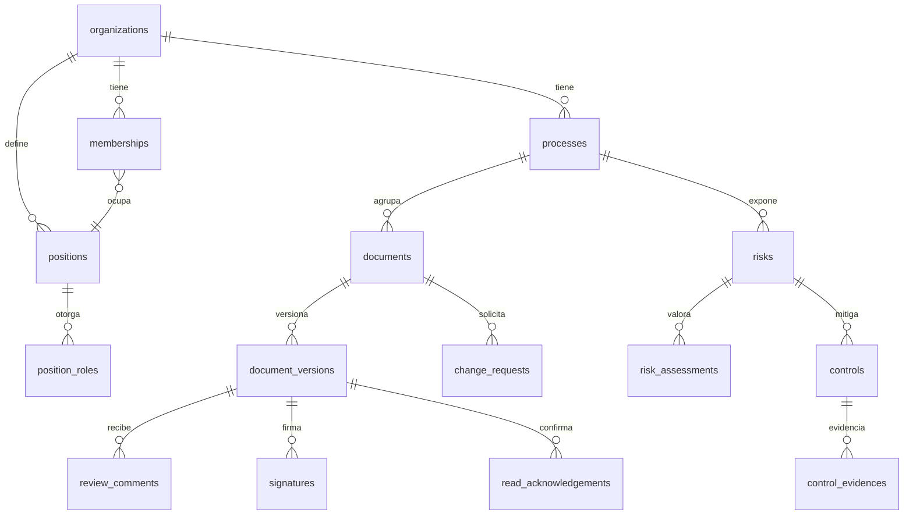

# ARQUITECTURA — CrubolDocs (v1 / MVP)

> Fase: arquitectura. Estado: **aprobado por Fernando (2026-09-23)**.
> Decisiones con alternativas en `docs/adr/`.

## 1. Negocio

- **Problema:** las empresas con un SIG (ISO 9001 y afines) trabajan con versiones desactualizadas, revisiones reactivas y manuales, y repositorios sin permisos ni trazabilidad. Mantienen un Excel paralelo como lista maestra y matriz de riesgos.
- **Para quién:** empresas con un sistema de gestión (primer cliente: piloto del caso E3). Usuarios: Líder SIG, líderes de proceso, elaboradores, revisores, aprobadores, responsables de control, auditores y personal de consulta.
- **Acción de valor:** un documento pasa de borrador a **vigente** con revisión, aprobación firmada y lectura confirmada, sin salir de la app.
- **Cobro:** **sin cobro en v1** (prueba de concepto). Stripe en una fase posterior (ADR-005).
- **Mercado:** Colombia / LATAM. Los datos personales se tratan bajo la Ley 1581.
- **Onboarding:** el Superadministrador (Crubol) crea la organización y su Administrador; el Administrador invita a los usuarios por correo. No hay autoregistro.

## 2. Modelo de dominio

Multi-tenant por `organization_id` en **toda** tabla de negocio, con RLS activo. 🔒 = dato sensible (RLS estricto y auditoría).

### Identidad, acceso y roles
| Entidad | Atributos clave | Notas |
|---|---|---|
| `organizations` | name, nit, status, recert_period_days (180), risk_scale (5×5) | Solo la crea el Superadmin |
| `platform_admins` | user_id | Superadministradores de Crubol. Gestionan organizaciones; **no leen contenido** de documentos |
| `profiles` 🔒 | id (=auth.users), full_name, email | |
| `positions` (cargos) | org_id, name, process_id? | Los roles se asignan al **cargo**, no a la persona |
| `position_roles` | position_id, role, process_id? (alcance) | role ∈ lider_sig, lider_proceso, elaborador, revisor, aprobador, responsable_control, auditor, consulta |
| `memberships` 🔒 | org_id, user_id, position_id, is_org_admin, is_external, valid_from, **valid_until**, status, last_recertified_at | Vigencia: fuera de rango = sin acceso (lo aplica el helper de RLS). Externo: `valid_until` obligatorio |
| `invitations` | org_id, email, position_id, token_hash, expires_at | |
| `access_recertifications` | membership_id, reviewed_by, decision (mantener/revocar), at | Periódica según `recert_period_days` |

**Administrador de empresa = solo metadatos:** ve títulos, códigos, estados, usuarios y trazas, pero **no descarga ni visualiza archivos**, salvo que su cargo tenga además un rol funcional. Se aplica en las políticas de Storage y en las de las tablas de contenido.

### Control documental
| Entidad | Atributos clave | Notas |
|---|---|---|
| `processes` | org_id, code, name, type (estratégico/misional/apoyo/evaluación), leader_position_id | Alimenta el mapa de procesos (vista estática por tipo, **sin** drag & drop) |
| `document_types` | org_id, code (MA, PR, FO, IN…), name | |
| `documents` | org_id, process_id, type_id, **code** (único por org), title, status, current_version_id, elaborador/revisor/aprobador **_position_id**, review_every_months, next_review_date, read_required | status ∈ borrador, en_revisión, en_aprobación, vigente, obsoleto |
| `document_distribution` | document_id, position_id | Cargos que deben confirmar la lectura |
| `document_versions` 🔒 | document_id, version_no, status, change_summary, source_path, source_sha256, pdf_path, pdf_sha256, elaborated_by, reviewed_by, approved_by, approved_at, effective_date | **Inmutable al aprobarse** (trigger). **Segregación de funciones** (trigger): elaborador ≠ revisor ≠ aprobador |
| `review_comments` | version_id, author_id, body, resolved_at | Revisión técnica con comentarios |
| `change_requests` | document_id, requested_by, reason, status (abierta/aceptada/rechazada), resolved_by, new_version_id | Solicitar la actualización de un documento vigente |
| `read_acknowledgements` | version_id, user_id, acknowledged_at | Única por (versión, usuario) |
| `signatures` 🔒 | version_id, signer_id, action (revisión/aprobación), meaning, file_sha256, reauth_at, ip, user_agent, signature_hash | Solo inserción. Firma electrónica simple (ADR-004) |

### Riesgos
| Entidad | Atributos clave | Notas |
|---|---|---|
| `risks` | org_id, process_id, code, description, cause, consequence, category, owner_position_id, status | |
| `risk_assessments` | risk_id, kind (inherente/residual), probability 1–5, impact 1–5, level (calculado), assessed_by, assessed_at | Historial: una fila por valoración y nunca se sobrescribe |
| `controls` | risk_id, description, type (preventivo/detectivo/correctivo), frequency, responsible_position_id, next_due_date | |
| `control_evidences` 🔒 | control_id, executed_at, result (efectivo/no efectivo), notes, file_path, file_sha256, registered_by | Solo inserción |

### Transversal
| Entidad | Uso |
|---|---|
| `tasks` | Bandeja. type ∈ revisar, aprobar, corregir, atender_solicitud, confirmar_lectura, ejecutar_control, revisar_documento_vencido, recertificar_accesos. Se asigna **al cargo** (`assignee_position_id`) y se resuelve a los usuarios vigentes que lo ocupan. La generan triggers o acciones de servidor, nunca el usuario a mano |
| `audit_log` 🔒 | Solo inserción: actor, acción, entidad, diff y fecha. Sirve de trazabilidad y de base para los indicadores de los 90 días |
| `email_outbox` | Cola de correos (to, template, payload, status, attempts) (ADR-003) |

### Flujo del documento (máquina de estados de la versión)
`borrador` → (elaborador envía) → `en_revisión` → revisor: **devuelve con comentarios** (→ `borrador`) | **firma revisión** → `en_aprobación` → aprobador: **rechaza** (→ `borrador`) | **firma aprobación** → `aprobada` (la anterior pasa a `reemplazada`, el documento queda `vigente` y se generan las tareas de *confirmar lectura* para los cargos de distribución).

## 3. Alcance del MVP

| Feature | ¿v1? | Justificación |
|---|---|---|
| Registrar documento (con PDF y fuente) | ✅ | Acción 2 |
| Revisión técnica con comentarios | ✅ | Acción 7 |
| Aprobar versión con firma electrónica simple | ✅ | Acción 1. Reautenticación + registro + hash |
| Solicitar actualización de documento vigente | ✅ | Acción 4 |
| Confirmar lectura | ✅ | Acción 6. Ataca el uso de versiones desactualizadas |
| Identificar y valorar riesgo (inherente/residual) | ✅ | Acción 3 |
| Registrar evidencia de control | ✅ | Acción 5 |
| Bandeja con tareas asignadas por cargo | ✅ | Hace que funcione sin comunicación externa |
| Notificaciones por correo (SMTP) | ✅ | Definido en v1 |
| Exportar lista maestra y matriz de riesgos | ✅ | **CSV UTF-8 con BOM** (abre en Excel, sin dependencias) |
| Roles por cargo, vigencia, externos, recertificación | ✅ | Ajustes acordados |
| Admin solo metadatos | ✅ | Ajuste acordado |
| Auditoría (audit_log) visible al Auditor | ✅ | Trazabilidad y base de indicadores |
| Alertas de revisión periódica vencida | ✅ | Revisiones proactivas (cron diario) |
| Visor PDF en navegador | ✅ | ADR-002 |
| Comparación de versiones Word/Excel | ❌ | Punto técnico abierto → hoja de ruta |
| Cobro / Stripe | ❌ | ADR-005 |
| Autoregistro, landing y precios | ❌ | Alta por Superadmin |
| Modelador drag & drop de procesos | ❌ | Hoja de ruta (el mapa de v1 es estático) |
| Integraciones, reportes avanzados, editor en línea, firma certificada, app móvil, IA | ❌ | Fuera de alcance explícito |

### Camino dorado
1. El Superadmin crea la organización y su Administrador.
2. El Administrador crea procesos, tipos y cargos, asigna los roles a los cargos e invita a los usuarios.
3. El Elaborador registra el documento (PDF + fuente) y lo envía.
4. El Revisor recibe la tarea (bandeja + correo), comenta, corrige y firma la revisión.
5. El Aprobador firma la aprobación (reautenticación) y el documento queda **vigente**.
6. Los cargos de distribución reciben *confirmar lectura* y la confirman.
7. Cualquier usuario puede solicitar una actualización. El ciclo vuelve a empezar con la versión N+1.

En paralelo, del lado de riesgos:
1. El Líder de proceso identifica y valora el riesgo, y define los controles con su responsable.
2. El Responsable de control recibe la tarea periódica y registra la evidencia.

## 4. Mapa de rutas

**Públicas:** `/` (redirige a `/login` o a `/app`), `/login`, `/recuperar`, `/invitacion/[token]` (aceptar invitación y definir contraseña).

**Privadas (5 pantallas):**
| Ruta | Pantalla | Quién |
|---|---|---|
| `/app` | **Inicio / Bandeja**: tareas pendientes por vencimiento, accesos rápidos y resumen (documentos por vencer, controles pendientes) | Todos |
| `/app/documentos` | **Documentos**: mapa de procesos (por tipo) + lista maestra filtrable, registro de documento en panel, exportar CSV | Todos (filtrado por RLS). Registrar: Elaborador/Líder |
| `/app/documentos/[id]` | **Ficha**: metadatos, visor PDF, historial de versiones, comentarios de revisión, firmas, lecturas, solicitudes, acciones según el rol y el estado | Según rol. El Admin ve solo metadatos |
| `/app/riesgos` | **Riesgos**: matriz de calor P×I + lista, panel lateral (`?riesgo=id`) con valoraciones, controles y evidencias, exportar CSV | Líderes, Responsable de control, Auditor, Consulta (lectura) |
| `/app/admin` | **Administración** (pestañas): usuarios e invitaciones, cargos y roles, procesos, tipos de documento, recertificación, auditoría. Pestaña *Organizaciones* solo para el Superadmin | Admin org, Líder SIG, Auditor (auditoría, lectura), Superadmin |

## 5. Integraciones y riesgos

| Servicio | Uso | Si falla |
|---|---|---|
| Supabase Auth | Login por contraseña, invitaciones, reautenticación de firma | Sin alternativa en v1; SLA de Supabase |
| Supabase Storage | Bucket privado; ruta `org_id/doc_id/version/…`; URLs firmadas cortas | Los metadatos siguen disponibles; se reintenta la carga |
| SMTP (Crubol o el cliente) vía `nodemailer` | Tareas, vencimientos, invitaciones | Outbox con reintentos. La **bandeja es la fuente de verdad** y el correo es un aviso |
| Vercel Cron | Diario: vencimientos de revisión, controles, vigencias, recertificación, reintento de outbox | Endpoint idempotente; se puede ejecutar a mano |

Dependencias nuevas previstas: `@supabase/supabase-js` + `@supabase/ssr` (stack fijo) y `nodemailer` (envío SMTP, ADR-003).

**Top 3 riesgos técnicos**
1. **Complejidad de RLS** (roles por cargo con alcance por proceso, vigencia, admin solo metadatos). → Funciones helper `security definer` (`has_role(org, role, process)`, `is_active_member(org)`), una política por operación y pruebas de RLS por rol en la fase de testing.
2. **Integridad de las reglas de calidad** (inmutabilidad, segregación de funciones, historial). → Se aplican con **triggers en Postgres**, no solo en la UI; `signatures`, `audit_log` y `control_evidences` son solo inserción; hash SHA-256 de cada archivo.
3. **Correo desde serverless** (timeouts, límites del SMTP y cron diario en el plan Hobby de Vercel). → Envío inmediato tras la acción con respaldo en outbox + cron. Si se requiere más frecuencia, decidir el plan Pro de Vercel o un cron de Supabase (`pg_cron`) más adelante.

Otros: archivos grandes (límite de Storage; tope de 25 MB por archivo en v1) y la comparación de Word/Excel (pendiente, ADR-002).

## Criterios de aceptación (verificables al cerrar la v1)
- **Día 1, por rol:** cada rol completa su acción del camino dorado **solo con la bandeja y los correos**, sin coordinar por fuera.
- **Condiciones previas para medir a 90 días:** `audit_log` y `tasks` con marcas de tiempo permiten calcular el tiempo de ciclo de aprobación, el % de lectura confirmada, las revisiones vencidas, los controles con evidencia a tiempo y los usuarios activos. La lista maestra exportable reemplaza el Excel paralelo.
- **Seguridad:** RLS en todas las tablas, bucket privado, admin sin acceso a contenido, auditoría antes del deploy.
